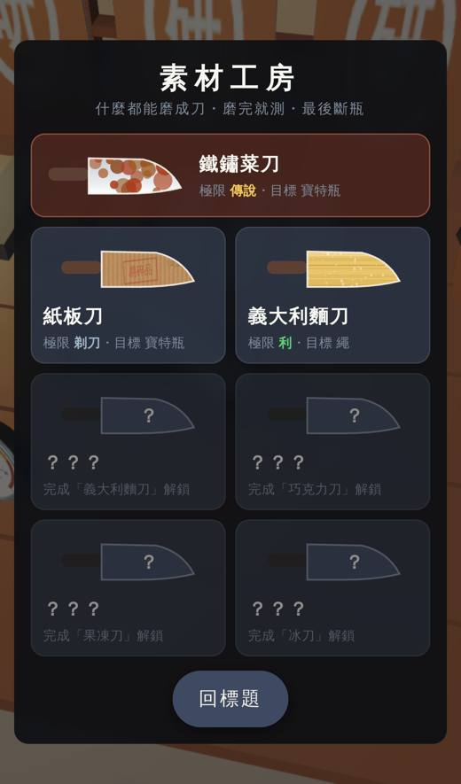
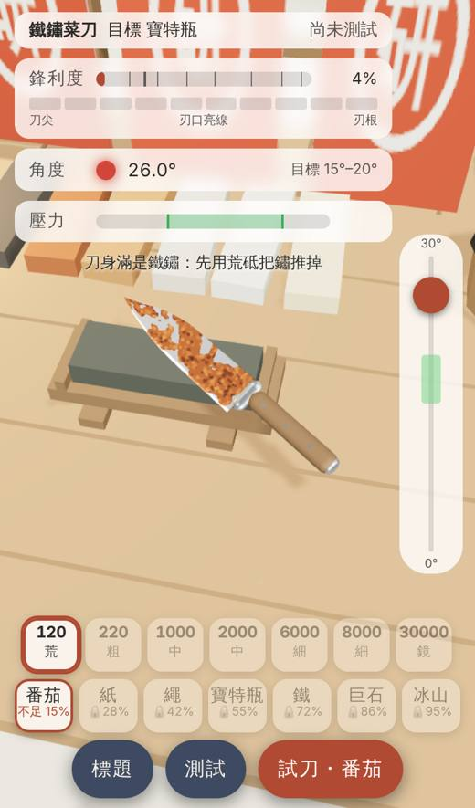
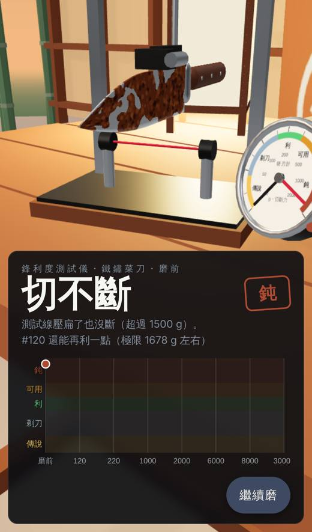
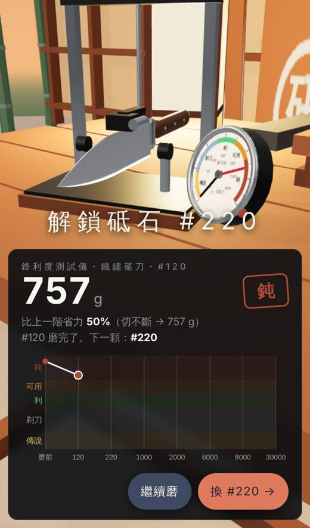
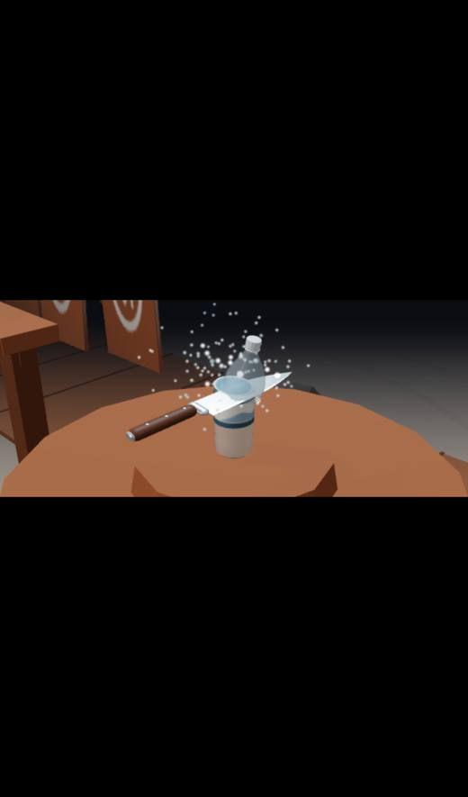
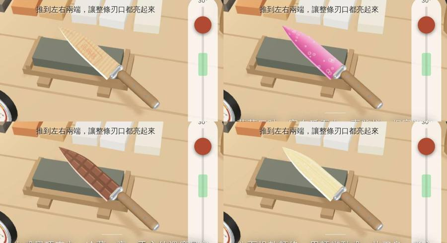
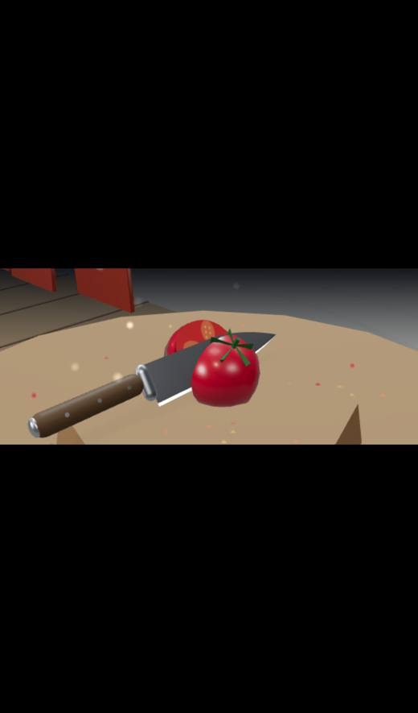
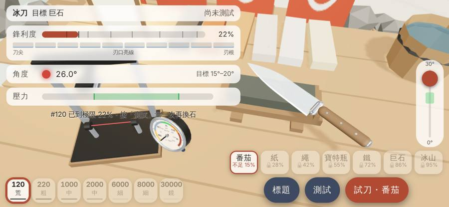

# NOTES — 玩法線（cloud/gameplay-r7）

- 2026-10-26 | who: claude-cloud-gameplay via Claude Code cloud (Claude；模型版本記在專案對話) | reviewer: 待指派（不同模型）
- 分支：`cloud/gameplay-r7`（從 main 9b4f671 開出；沒有合併進 main、沒有部署、沒有動 GitHub Pages）
- 依據：2026-10-26 設計方向更新（把各種東西磨成刀，用鋒利度測試儀驗證，最後一刀橫切寶特瓶）。只借概念，沒有使用任何頻道的名字、頭像、影片或聲音；所有文案原創、繁體中文；沒有新增任何外部模型或貼圖（全部程式生成）；沒有使用 Codex。

## 做了什麼

| 項目 | 內容 | 檔案 |
| --- | --- | --- |
| 素材工房（新主流程） | 標題「開始・素材工房」→ 選素材 → 開場自動「磨前」測一次 → 7 顆砥石逐階磨，每階磨到上限後測試才解鎖下一顆 → 試刀 → 完成目標就解鎖下一把素材刀。進度存 `localStorage['knife.lab.v1']` | main.js（「素材工房」段）、index.html |
| 砥石番數 | #120 荒 → #220 粗 → #1000 中 → #2000 中 → #6000 細 → #8000 細 → 終局 #30000 鏡（上限 22/36/55/68/82/90/100%），各自的磨速、磨耗、除鏽力、音色；#30000 把金屬刀面拋成鏡面（粗糙度 0.12 → 0.025，95% 時「鏡面」演出） | main.js `STONES` |
| 鋒利度測試儀 | 桌上的實體道具：底座、兩根柱子拉著紅色測試線、龍門架＋導螺桿＋夾具夾住刀背、對數刻度錶盤（黑色主針＋紅色峰值針、等級色帶）。測試時刀從砥石移到夾具，壓線 → 線呈 V 形下沉、主針爬升、張力聲升高 → 線斷（叮聲、閃光、震動）→ 讀數面板上滑：克數、等級印章（鈍/可用/利/剃刀/傳說）、比上一階省力 %、折線圖（越利畫得越高） | tester.js、main.js（測試儀段） |
| 克重模型 | 切斷力 = 2000 g ×(25/2000)^鋒利度 ×(1 + 1.2×平均鏽)；≥1500 g「切不斷」。等級門檻 600/300/150/45 g | main.js `FORCE`、`GRADES` |
| 鐵鏽菜刀 | 刀身覆一層鏽（雜訊貼圖 × 每段鏽量，alphaTest 溶解，所以鏽是一塊塊剝落，不是整片變淡）；粗石刷得快、細石慢；有鏽時磨得慢、泥水是鏽色、測試讀數偏重；每段除完有鏽屑＋亮點，全部除完「除鏽完成！」和弦＋旁白 | main.js（rust overlay）、materials.js `makeRustTextures` |
| 試刀階梯 | 番茄 15% → 紙 28% → 繩 42% → 寶特瓶 55% → 鐵 72% → 巨石 86% → 冰山 95%（移除卷藁）。番茄有剖面（果肉、籽室）與蒂、繩子掛在小木架上 | main.js `TARGETS`、`TARGET_BUILD` |
| 寶特瓶高潮 | 預切兩半（載入時切好，不即時切割）、切面幾乎水平（82°），刀橫掃；上半截順切面滑落；慢動作多停 0.9 秒、鏡頭拉近；切口噴水＋1.4 秒持續灑水（慢動作中懸在空中）＋水聲（濕拍＋水幕＋水滴）；原創標籤「清泉」 | main.js（`cutBasis`、`updateSpill`、`audio.splash`） |
| 素材刀 6 種 | 紙板（上限 60%，目標寶特瓶）、義大利麵（50%，繩）、巧克力（66%，寶特瓶）、果凍（45%，繩，磨的時候會抖）、冰（86%，巨石）、石頭（76%，鐵）。各有磨速、程式繪製外觀（紙箱「易碎品」印章、麵條紋、巧克力格、果凍氣泡、冰裂紋、石英紋）、磨屑顏色、磨聲顆粒感、開場／中段／完成三句原創旁白 | materials.js |
| 旁白 | 襯線字、上下細線、置中偏下，淡入淡出；試刀時移到黑邊上 | index.html `#narr` |
| 版面 | 7 顆砥石：直式放在底部一列（試刀目標上方），橫式放左下；試刀目標按鈕不再直排換行；結果標題過長自動縮字 | index.html |

測試掛鉤：`window.__knife.startLab(i|id)`、`lab()`、`measure()`、`closeMeasure(next)`、`grind(passes)`、`unlockMaterials(n)`、`materials`、`grades`、`force`。舊掛鉤保留；砥石 id `coarse`/`medium`/`fine` 仍對應 #220/#1000/#6000。

## 測試結果（Playwright 無頭 Chromium，iPhone 13 模擬，SwiftShader 軟體繪圖）

- 素材工房流程：開始 → 鐵鏽菜刀 → 自動磨前測試 = 切不斷（1500 g，鈍）→ 磨 1.2 趟：鋒利度 16%、平均鏽 0.10 → 再 3 趟：22%（#120 上限）、鏽 0 → 測試 757 g（鈍）、比上一階省力 50%、解鎖 #220 → 「換 #220」後砥石 = coarse。無主控台錯誤。
- 寶特瓶：鋒利度 0.6 試刀成功，頓幀 80 ms，切後 59%（刃口磨損 1%），無錯誤。
- 番茄、繩：切開成功（見截圖）。
- 素材刀外觀：紙板、果凍、巧克力、義大利麵各自載入、可磨，無錯誤。
- 平衡（理想手法模擬）：鐵鏽菜刀到寶特瓶約 8 趟、到 #30000 鏡面約 40 趟；紙板 6 趟、果凍 8 趟、石頭 29 趟。
- 軟體繪圖約 2–3 fps，數字不代表實機；效能請以效能線（perf-r7）的實機量測為準。

## 截圖

| | |
| --- | --- |
|  選素材 |  鐵鏽菜刀，鏽一塊塊剝落 |
|  磨前：切不斷 |  #120 磨完：757 g，折線圖往上 |
|  寶特瓶橫切＋水花 |  紙板／果凍／巧克力／義大利麵 |
|  番茄剖面 |  橫式版面（冰刀） |

## 美學自評（給審查者對照）

- 好：測試儀的錶盤（米白底、等級色帶、紅色峰值針）和工房的木頭色調一致；讀數面板沿用試刀高潮的深色卡片，大數字＋傾斜印章有「宣判」感；鏽的剝落是塊狀溶解，比整片淡出更像真的。
- 待改：直式畫面底部現在有兩列按鈕（砥石＋試刀目標）＋一列操作鈕，略擠。測試儀已往畫面內挪一點，磨刀時看得到錶盤。

## 已知限制 / 給其他線

- 穩定線：素材工房存檔目前是獨立 key `knife.lab.v1`，請整合進你的存檔結構（或讀取它遷移）。新的 `game.mode = 'measure'`、`flow.screen = 'measure' | 'lab'` 需要加進狀態機。
- 效能線：新增會動的物件：測試儀（carriage、測試線、指針）、每把刀的鏽網格、番茄／繩／寶特瓶的兩半與瓶蓋。素材刀材質在第一次選該素材時才建立（會現編著色器一次）。
- 委託與自由磨刀仍可玩，改用 7 顆砥石與新的試刀階梯；委託第 1 件是番茄。

## 下一個更有野心的版本

1. **讀數即分享卡**：測試儀面板一鍵輸出「磨前 → 磨後」對照圖（折線圖＋錶盤特寫＋素材名＋克數），這是最想截圖分享的瞬間，應該直接做成分享圖（等穩定線修好 iOS 分享後接上）。
2. **測試媒材升級**：測試線之外加「紙條」「橡皮筋」「頭髮」三種媒材，越利越能切更細的東西；頭髮豎切是傳說級的證明。
3. **素材的物理個性**：巧克力磨久會因手溫變軟（上限慢慢下降，要磨快）；冰刀磨越久越小；義大利麵磨太用力會斷一截。讓每種素材有一個要學的小技巧，而不只是數字不同。
4. **寶特瓶之後的第二高潮**：一排 5 個寶特瓶連斬、或裝滿水的西瓜；鏡頭沿刀路跟拍。
5. **觀眾留言彈幕**（原創虛構）：磨刀時偶爾飄過「這真的能切嗎」「已訂閱」之類的假留言，增加「在拍影片」的感覺。
