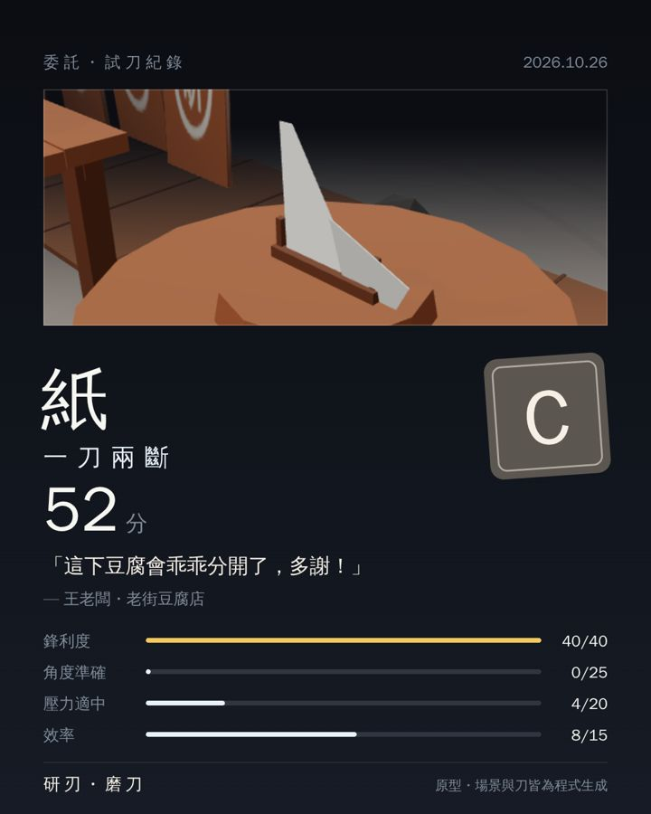

# NOTES_stability — 第 7 輪穩定性線（cloud/stability-r7）

- 2026-10-26 | who: claude-cloud-stability via Claude Code cloud (Claude Opus 5.5) | reviewer: 待指派（不同模型） | what: 見下 | why: 穩定性線任務＋第 6 輪審查遺留 iOS 分享 major
- 只推到 `cloud/stability-r7`，沒有合併 main、沒有部署、沒動 GitHub Pages。

## 做了什麼

為了少跟玩法線／效能線在 `main.js` 衝突，邏輯盡量放在新檔 `stability.js`（不依賴 three.js），`main.js` 只做局部接線，沒有大範圍重排。

### 1. 遊戲狀態機＋錯誤處理
- 畫面轉移表 `FLOW_EDGES`（stability.js）：title → order / sharpen；order → title / sharpen；sharpen → title / order / cut；cut → result（復原時 → sharpen）；result → sharpen / cut / order / title。`game.mode`（sharpen / test / result / exit）是 sharpen/cut/result 底下的子狀態。
- `main.js` 所有 `flow.screen = …` 都改走 `goScreen()`：合法就記進歷史；不合法仍套用（不讓玩家卡死），但記到 `window.__knife.issues`，測試要求 0 次。
- 例外處理：
  - `frame()` 包 try/catch。three.js 是在回呼「之後」才排下一幀，原本任何一個例外就會讓整個遊戲永久凍結。
  - tween 的 fn 丟例外時移除該 tween 並 reject 它的 Promise（以前會每幀重丟）。
  - 試刀 `runTest()` 包一層：動畫鏈出錯就 `recoverToSharpen()`（清 tween、慢動作、黑邊、頓幀、震動、刀具歸位），提示「剛剛卡了一下，已回到磨刀台」。
  - 看門狗：試刀超過 30 模擬秒、退場超過 8 模擬秒就自動復原。
  - WebGL context lost：暫停＋存檔＋「畫面暫停中」遮罩（有重新載入鈕）；restored 時重建 PMREM 環境貼圖後自動續跑。
  - 全域 `error` / `unhandledrejection` 都記錄到 `__knife.issues`。

### 2. localStorage 存檔（`knife.save`，版本 1）
- 存：完成委託數、最佳分數／評價、各評價次數、每種目標斬過幾次、自由模式的刃口（10 段）與解鎖、三顆砥石的磨耗、**磨到一半的委託**、設定（震動、新增的「音效」開關）。另留 `unlocks: {}` 給玩家線的素材刀解鎖用。
- 讀檔一律經 `sanitizeSave()` 驗證與夾範圍；JSON 壞掉時把原文備份到 `knife.save.corrupt` 再從頭開始；舊的 `knife.haptics` 自動搬進新檔；無痕／被鎖住的 localStorage 照樣能玩（狀態 `unavailable`）；寫入失敗（配額）不影響遊戲。
- 寫入時機：結果卡、回標題、分頁隱藏／pagehide、設定變更、磨刀中每 4 秒（有動才寫）。
- 標題畫面顯示紀錄（已完成 N 件、最佳 S・94 分、最高斬過…），「開始」變「繼續・第 N 件」；兩段式「清除紀錄」（3 秒內再點一次才清，設定保留）。
- `?fresh=1` 完全不讀不寫存檔（測試用）。

### 3. 失焦／回來、旋轉螢幕
- `visibilitychange`（hidden）、`pagehide`、`freeze`、WebGL lost → `pauseGame()`：停繪製迴圈、`AudioContext.suspend()`、`navigator.vibrate(0)`、放開手指、存檔。全部清除後才 `resumeGame()`：丟掉暫停期間的時間、重新取景（可能已旋轉）、恢復音效。
- `blur`（iOS 控制中心、通知）只放開手指，避免磨刀聲卡著。
- iOS 的 `interrupted` 狀態（來電、Siri）現在也會在下一次點擊時 resume（原本只處理 `suspended`）。
- 旋轉：放開手指、250ms 與 700ms 各重新取景一次（iOS 回報尺寸較晚）；`onResize` 遇到 0 尺寸直接略過（原本會把 aspect 算成 NaN）。
- 短橫向螢幕：結果卡改兩欄、所有卡片超高時在卡片內捲動（不捲整頁）。

### 4. 修 iOS Safari 分享（第 6 輪 major）
- 結果卡一出現就在背景把分享圖編成 PNG（`prepareShare()`）。
- 點擊處理器完全同步：拿現成的 File，第一個非同步動作就是 `navigator.share()`，使用者手勢不會丟。點太快（圖還沒好）就同步 `toDataURL` → Blob → File，一樣在點擊內呼叫。
- `AbortError`（使用者關掉分享選單）→ 什麼都不做；其他錯誤或瀏覽器不支援檔案分享 → 顯示預覽面板（長按圖片儲存＋「儲存圖片」下載連結，這是真的點擊所以 iOS 也能下載）；桌機會直接下載。
- 分享圖重新設計：1080×1350（4:5），上方是黑邊之間那段 2.39:1 的試刀畫面，下面是目標名、「一刀兩斷」、印章式評價、分數、客人那句話、四項分數條；配色用試刀高潮色板。

### 5. 測試（tests/）
- `node tests/stability.iphone13.mjs`：Playwright 無頭 iPhone 13（直向＋橫向裝置設定）。three.js 第一次用 curl 快取到 `tests/.cache/`（不進 git）。截圖、分享圖、`results.json` 輸出到 `tests/artifacts/`（不進 git）。

## 測試結果

**54 / 54 通過，495 秒**（SwiftShader 軟體繪圖約 3 fps，fps 不代表實機）。涵蓋：

| 項目 | 檢查 |
| --- | --- |
| 開機 | 標題畫面、首次存檔狀態 fresh、頁面不捲動 |
| 設定 | 震動／音效關閉後重新整理仍是關 |
| 委託流程 | 真實點擊開始→接下委託；CDP 真實觸控拖曳磨刀（距離、推拉次數 > 0）；試刀→結果 S/A/B/C；轉移順序 title>order>sharpen>cut>result，0 次不合法轉移 |
| 分頁隱藏 | 試刀動畫中隱藏：暫停、2 秒內 0 幀、動畫階段不前進、音效 suspended；回來後續跑並完成 |
| 分享 | `navigator.share` 在 click 分派「之內」被呼叫（預建與同步兩條路都是）；PNG > 20KB；AbortError 不備援；NotAllowedError → 預覽 1080×1350＋blob 下載連結 |
| 存檔 | 重新整理後完成數、紀錄、標題文字還在；自由模式刃口 60%＋解鎖鐵還在且不被委託覆蓋；磨到一半的委託（27%）重新整理後可「接著磨」 |
| 錯誤復原 | frame 丟例外後迴圈繼續；試刀中弄壞 tween → 回磨刀台（黑邊 0、試刀鈕可按、轉移仍合法），下一刀正常 |
| WebGL | lose → 遮罩＋暫停；restore → 遮罩消失、迴圈續跑、刀面反光正常 |
| 旋轉 | 試刀中直→橫：黑邊仍 2.39:1、畫布跟上新尺寸、結果卡與按鈕（≥44px）都在畫面內、不捲頁；再轉回直向一致 |
| pagehide/pageshow | 暫停／恢復；`?fresh=1` 不碰儲存 |
| 橫向委託結果 | 卡片在 342px 高內、分享仍在點擊內 |
| 壞存檔 | 壞 JSON → recovered＋備份；舊 knife.haptics 搬家；兩段式清除保留設定 |
| 沒有 localStorage | 仍可開始委託、無錯誤 |
| 全程 | 每段 0 個 pageerror / console.error |

第一次跑 44/47：2 個是測試寫法問題（evaluate 等完整段試刀動畫），1 個是真 bug（壞存檔時沒搬舊震動設定），已修。

## 截圖（notes/stability-r7/）

- 分享圖：
- 分享失敗備援預覽：`a4-share-preview.jpg`
- 標題紀錄：`a5-title-with-record.jpg`；接著磨的委託卡：`a9-order-resume.jpg`
- 橫向結果卡（兩欄）：`c2-landscape-order-result.jpg`、`b1-landscape-result.jpg`
- 自動復原後：`a6-recovered.jpg`；WebGL 暫停遮罩：`a7-context-lost.jpg`

## 美學自評
- 分享圖：留白、字距、印章、條狀圖一致用試刀高潮色板，是本輪最想被截圖的瞬間。缺點：截到的是「結果卡出現時」那一幀，若目標已倒下，畫面主體偏暗；下一步可改成在切開瞬間（頓幀）先存一張畫面給分享圖用。
- 橫向結果卡改兩欄後按鈕不再被切掉。暫停遮罩、預覽面板沿用既有深色卡片與按鈕樣式。

## 給整合線的注意事項
- `main.js` 改動點：import stability.js；`buildEnvironment()`；audio `muted`/`setMuted`；tween reject；存檔／錯誤區塊（在 ui 物件後）；`goScreen()`；`runTest()` → 包裝 `runCut()`；分享區塊整段換新；存檔／復原區塊（在 Flow screens 前）；`onResize` 0 尺寸、`onRotate()`；`frame()` → 包裝 `stepFrame()`；visibilitychange 區塊整段換成 lifecycle（效能線的 `quality.settle()` 請放進 `resumeGame()`）。
- 新測試掛鉤：`__knife.save / saveNow() / resetSave() / fsm / issues / lifecycle / share / debug.{throwInFrame, breakNextTween, loseContext, restoreContext, dropShareCache}`。
- 玩法線的素材刀解鎖可直接寫 `save.data.unlocks[id] = true` 後 `save.save()`。

## 下一個更有野心的版本
1. **分享「影片」而不只是圖**：在頓幀前後用 `canvas.captureStream()` + `MediaRecorder`（iOS 14.5+ 可錄 mp4）錄 3 秒慢動作，結果卡直接分享短片；同樣要預錄好才能在點擊內同步分享。
2. **存檔雲端化／跨裝置**：匯出成 QR code 或短碼，iPhone 與電腦之間搬存檔；之後 Steam 版可對應 Steam Cloud。
3. **崩潰回報**：`__knife.issues` 在下次開啟時顯示「上次有 N 個問題，要不要送出」，送到一個只收 JSON 的端點（需使用者同意與隱私說明）。
4. **實機 iPhone 驗證**：這輪全在無頭 Chromium 模擬；Safari 特有的 `interrupted` 音訊、分享選單、背景回收 WebGL 需要真機跑一次（能力邊界：雲端環境沒有 iOS Safari）。
